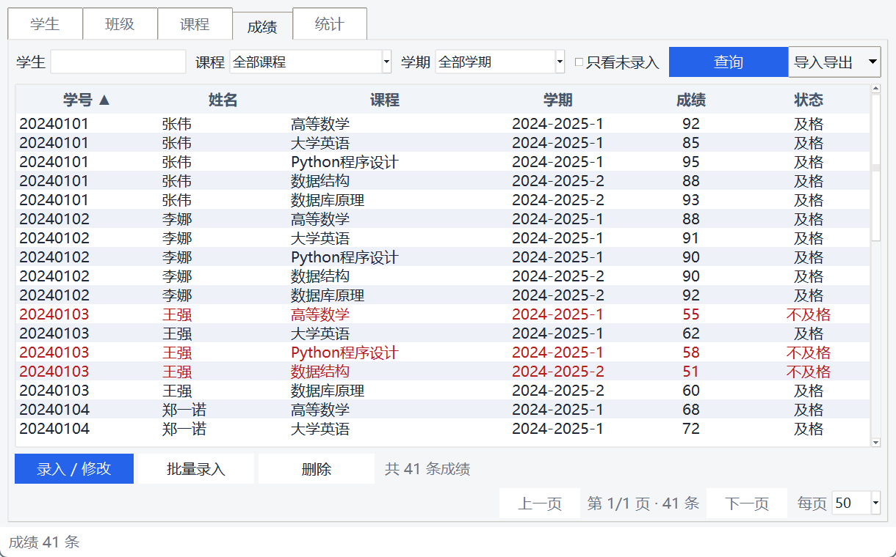
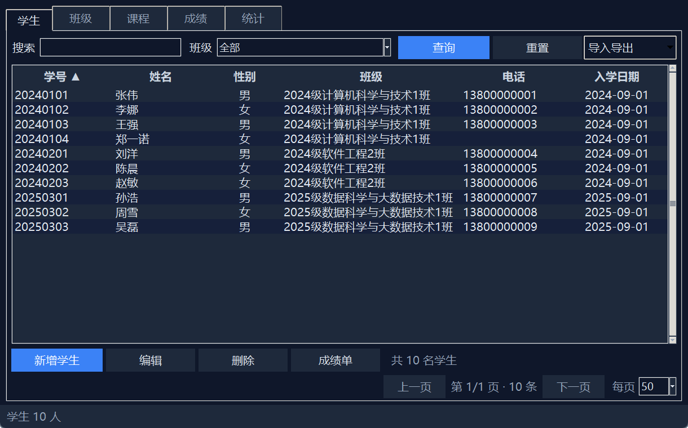
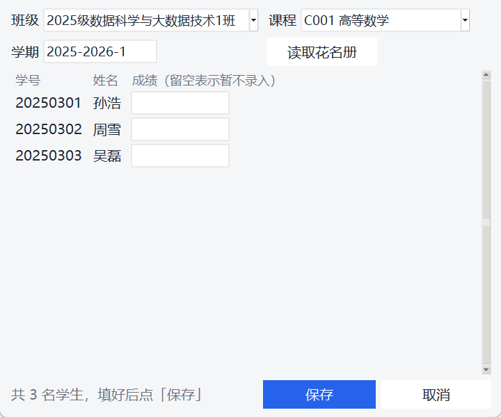

# python-project2

《挑战课题—Python 编程》课题 II：**数据库编程 —— 基于 Python 的管理信息系统设计**。

选题《学生管理系统》：Python 标准库 `sqlite3` + Tkinter，零第三方依赖，一个命令即可建库运行。
支持万行级数据的分页浏览、批量录入、CSV 导入导出、浅色 / 深色主题。


## 能做什么

- **浏览 / 搜索 / 排序**：按学号、姓名、电话模糊搜索，按班级筛选，点表头排序
- **分页**：每页 20 / 50 / 100 / 200 条可选，1 万学生下单页查询 1–3 ms
- **增删改**：学生、班级、课程、成绩四类数据都能在界面上增删改
- **成绩录入**：按「学号 + 课程号 + 学期」单条录入，留空表示「未录入」
- **批量录入**：选「班级 + 课程 + 学期」，一张表里一次填完整班成绩
- **CSV 导入导出**：学生名册、成绩明细都可导入导出，逐行报错不中断
- **成绩单**：单个学生导出 CSV，或生成可打印 HTML（浏览器里 Ctrl+P）
- **统计报表**：班级人数与平均分、每门课的均分/最高/最低/及格率、加权平均分排行
- **深色模式**：菜单「视图 → 深色主题」，偏好记在 `data/ui.json`
- **两种界面**：Tkinter 图形界面（默认）与命令行界面，共用同一套业务层

| 页签 | 说明 |
| ---- | ---- |
| 学生 | 搜索、班级筛选、排序、分页、成绩单、CSV 导入导出 |
| 班级 | 班级增删改，显示每班人数 |
| 课程 | 课程增删改，显示成绩条数 |
| 成绩 | 按学生 / 课程 / 学期筛选，只看未录入，批量录入 |
| 统计 | 班级概览、课程统计、加权排行 |




深色主题与批量录入：




## 快速开始

```powershell
# 1) 建库并灌入示例数据（3 个班 / 10 名学生 / 5 门课 / 41 条成绩）
python main.py init --reset

# 2) 图形界面
python main.py

# 3) 命令行界面
python main.py cli students list
python main.py cli students list --keyword 王 --sort name
python main.py cli students list --page 2 --size 4
python main.py cli scores list --student-id 3
python main.py cli stats courses
```

`python main.py cli -h` 查看全部子命令。退出码：`0` 成功，`1` 业务错误（如学号重复），`2` 参数或配置错误。

常用命令行操作：

```powershell
python main.py cli students add --sno 20260301 --name 林小满 --gender 女 --class-id 3
python main.py cli students edit 11 --phone 13800000010
python main.py cli students show 3                     # 成绩单
python main.py cli students delete 11                  # 成绩级联删除
python main.py cli students import --file 学生.csv      # 批量导入（列：学号,姓名,性别,班级,...）
python main.py cli students transcript 3 --out 成绩单.html

python main.py cli scores set --student-id 3 --course-id 1 --term 2024-2025-1 --score 65
python main.py cli scores list --missing               # 只看未录入
python main.py cli scores import --file 成绩.csv        # 列：学号,课程号,学期,成绩
python main.py cli export --what scores --out scores.csv
```

CSV 表头支持中文或英文字段名；图形界面里「导入导出 → 保存导入模板」可以生成一份照填即可的模板。

## 目录结构

```
python-project2/
├─ main.py                 统一入口：init / GUI / CLI
├─ config.json             数据库路径、分页大小、窗口尺寸、主题
├─ db/
│  ├─ schema.sql           4 张表 + 3 个视图 + 触发器 + 5 个索引
│  └─ seed.sql             示例数据（含 NULL、不及格、跨学期等边界样本）
├─ common/                 配置、异常、日志、分页计算、终端表格
├─ store/                  数据访问层：只写 SQL，不校验、不弹窗
│  ├─ connection.py        连接、事务、建库（每个连接都开外键）
│  ├─ students.py / classes.py / courses.py / scores.py
├─ service/                业务层：校验、异常翻译、统计口径
│  ├─ imports.py           CSV 导入（逐行报错）
│  ├─ exports.py           名册/成绩/成绩单导出、可打印 HTML
│  └─ reports.py           班级、课程、排行统计
├─ ui/
│  ├─ theme.py             浅色 / 深色两套 ttk 样式
│  ├─ tk_app.py            五页签界面、分页器、表单弹窗、批量录入
│  └─ cli_app.py           argparse 子命令 + 等宽表格输出
├─ tools/benchmark.py      万行级基准：造数据、测分页、看执行计划
├─ tests/                  105 个单元测试（标准库 unittest）
└─ docs/                   数据库说明文档与界面截图
```

## 数据模型

```
classes 1 ──< students 1 ──< scores >── 1 courses
   (班级)        (学生)         (成绩)        (课程)
```

- `scores` 用复合主键 `(student_id, course_id, term)`：同一学生同一门课重修时靠学期区分，重复录入会被数据库拦下
- 成绩允许 NULL：区分「还没考」与「考了 0 分」，聚合时自动跳过
- 删班级 → 学生 `class_id` 置 NULL（未分班）；删学生 / 删课程 → 成绩级联删除
- 改成绩由触发器自动刷新 `updated_at`
- SQLite 外键默认关闭，`store/connection.py` 在每个连接上显式 `PRAGMA foreign_keys = ON`

完整字段、约束、ER 图与查询示例见 [docs/课题2-数据库内容说明.md](docs/课题2-数据库内容说明.md)。

## 性能：万行级实测

```powershell
python tools/benchmark.py --students 10000
```

本机（SQLite 3.53 / Python 3.12）实测：

| 场景 | 中位耗时 |
| ---- | -------- |
| 学生第 1 页 / 第 10 页 | 1.5 ms / 1.3 ms |
| 学生按班级筛选 | 1.7 ms |
| 成绩第 1 页 | 11 ms |
| 成绩按学期筛选 | 19 ms |
| 课程聚合统计 | 12 ms |
| 加权排行（全表） | 46 ms |

分页查询全部走索引：`idx_students_class_name`、`idx_scores_term`、`idx_scores_course`，
`EXPLAIN QUERY PLAN` 可在基准脚本输出里核对。`LIKE '%关键字%'` 无法走索引，属于预期内的全表扫描。

## 测试

```powershell
python -m unittest discover -s tests -t .
```

105 个用例：建表与约束、外键级联、触发器、三个视图的统计口径、分页边界、CSV 导入逐行报错、
成绩单导出、批量录入、命令行输出、图形界面冒烟（无图形环境自动跳过）。

## 约定

- **不引入第三方依赖**，全部使用标准库；换机器即可运行。
- 数据库、日志、测试临时目录已在 `.gitignore` 中忽略；`data/student.db` 由 `init` 生成。
- 运行日志写到 `logs/app.log`（1 MB × 3 轮转），出错时同时打一份到控制台。
- 提交信息用 `<类型>: <中文说明>`，类型取 `feat`、`fix`、`docs`、`test`、`chore`。
- 提交前 `python -m unittest discover -s tests -t .` 必须通过。
