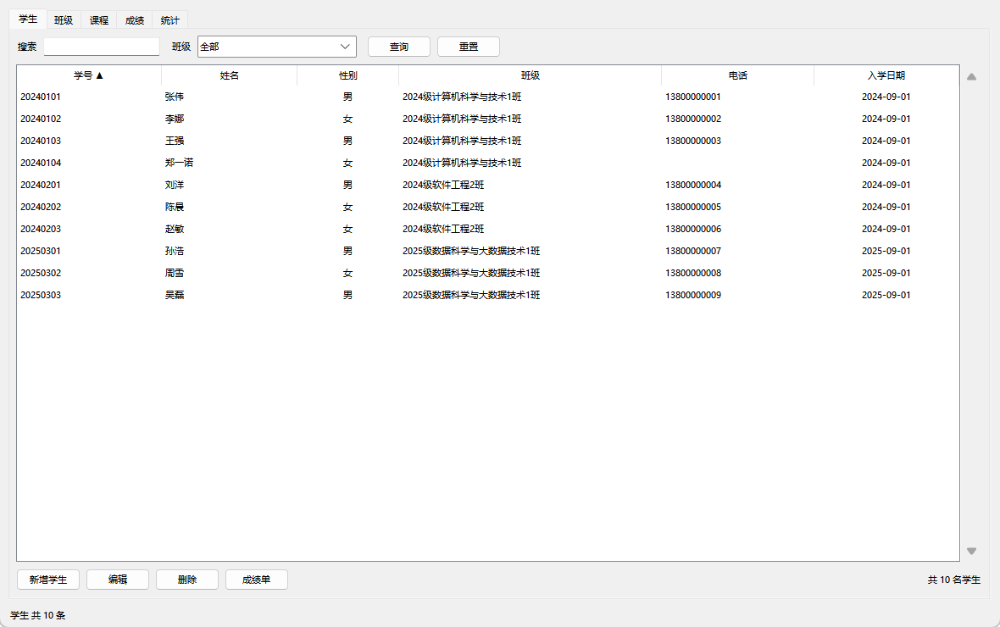
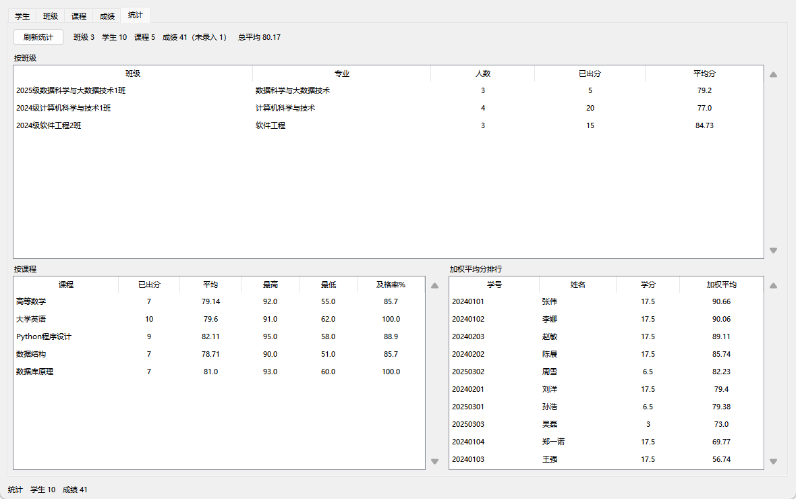

# python-project2

《挑战课题—Python 编程》课题 II：**数据库编程 —— 基于 Python 的管理信息系统设计**。

选题《学生管理系统》：Python 标准库 `sqlite3` + Tkinter，零第三方依赖，一个命令即可建库运行。



## 能做什么

- **浏览 / 搜索 / 排序**：按学号、姓名、电话模糊搜索，按班级筛选，点表头排序
- **增删改**：学生、班级、课程、成绩四类数据都能在界面上增删改
- **成绩录入**：按「学生 + 课程 + 学期」录入，可先占位（未录入 / NULL）后补分
- **统计报表**：班级人数与平均分、每门课的均分/最高/最低/及格率、加权平均分排行
- **数据导出**：学生名册与成绩明细导出 CSV（`--what students|scores`）
- **两种界面**：Tkinter 图形界面（默认）与命令行界面，共用同一套业务层

| 页签 | 说明 |
| ---- | ---- |
| 学生 | 搜索、班级筛选、排序、成绩单 |
| 班级 | 班级增删改，显示每班人数 |
| 课程 | 课程增删改，显示成绩条数 |
| 成绩 | 按学生 / 课程 / 学期筛选，只看未录入 |
| 统计 | 班级概览、课程统计、加权排行 |




## 快速开始

```powershell
# 1) 建库并灌入示例数据（3 个班 / 10 名学生 / 5 门课 / 41 条成绩）
python main.py init --reset

# 2) 图形界面
python main.py

# 3) 命令行界面
python main.py cli students list
python main.py cli students list --keyword 王 --sort name
python main.py cli scores list --student-id 3
python main.py cli stats courses
```

`python main.py cli -h` 查看全部子命令。退出码：`0` 成功，`1` 业务错误（如学号重复），`2` 参数或配置错误。

常用命令行操作：

```powershell
python main.py cli students add --sno 20260301 --name 林小满 --gender 女 --class-id 3
python main.py cli students edit 11 --phone 13800000010
python main.py cli students show 3                     # 成绩单
python main.py cli students delete 11                  # 成绩级联删除

python main.py cli scores set --student-id 3 --course-id 1 --term 2024-2025-1 --score 65
python main.py cli scores list --missing               # 只看未录入
python main.py cli export --what scores --out scores.csv
```

## 目录结构

```
python-project2/
├─ main.py                 统一入口：init / GUI / CLI
├─ config.json             数据库路径、窗口尺寸等运行参数
├─ db/
│  ├─ schema.sql           4 张表 + 3 个视图 + 触发器 + 索引
│  └─ seed.sql             示例数据（含 NULL、不及格、跨学期等边界样本）
├─ common/                 配置加载、异常类型、终端表格
├─ store/                  数据访问层：只写 SQL，不校验、不弹窗
│  ├─ connection.py        连接、事务、建库
│  ├─ students.py / classes.py / courses.py / scores.py
├─ service/                业务层：输入校验、异常翻译、统计口径
├─ ui/
│  ├─ tk_app.py            Tkinter 界面（五个页签 + 表单弹窗 + 成绩单）
│  └─ cli_app.py           argparse 子命令 + 等宽表格输出
├─ tests/                  64 个单元测试（标准库 unittest）
└─ docs/                   数据库说明文档与界面截图
```

## 数据模型

```
classes 1 ──< students 1 ──< scores >── 1 courses
   (班级)        (学生)         (成绩)        (课程)
```

- `scores` 用复合主键 `(student_id, course_id, term)`：同一学生同一门课重修时靠学期区分，重复录入会被数据库拦下
- 成绩允许 NULL：区分「还没考」与「考了 0 分」，聚合时自动跳过
- 删班级 → 学生 `class_id` 置 NULL（未分班）；删学生 / 删课程 → 成绩级联删除
- 改成绩由触发器自动刷新 `updated_at`
- SQLite 外键默认关闭，`store/connection.py` 在每个连接上显式 `PRAGMA foreign_keys = ON`

完整字段、约束、ER 图与查询示例见 [docs/课题2-数据库内容说明.md](docs/课题2-数据库内容说明.md)。

## 测试

```powershell
python -m unittest discover -s tests -t .
```

覆盖：建表与约束、外键级联、触发器、三个视图的统计口径、业务层校验与异常翻译、命令行输出、图形界面冒烟（无图形环境时自动跳过）。

## 约定

- **不引入第三方依赖**，全部使用标准库；换机器即可运行。
- 数据库文件、日志、测试临时目录已在 `.gitignore` 中忽略；`data/student.db` 由 `init` 生成。
- 提交信息用 `<类型>: <中文说明>`，类型取 `feat`、`fix`、`docs`、`test`、`chore`。
- 提交前 `python -m unittest discover -s tests -t .` 必须通过。
