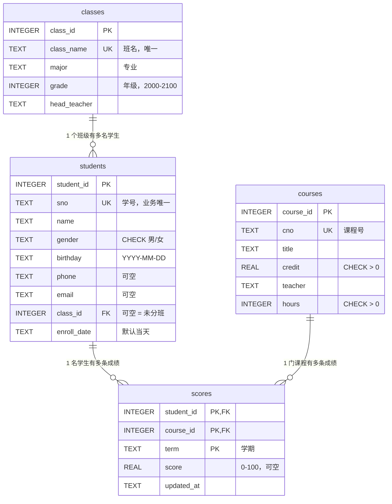
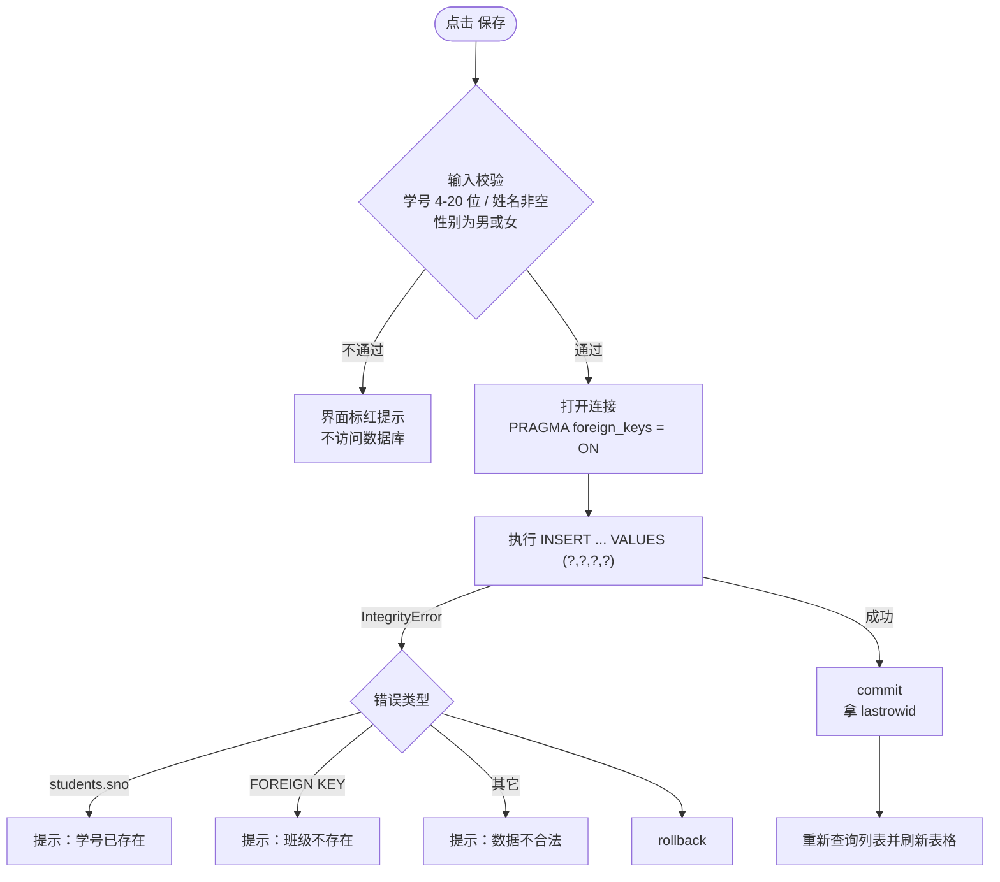

# 课题2 · 学生管理系统 —— 数据库内容说明

> **这份文档回答一个问题：课题2 的数据库里到底有什么、为什么是这些、以及它怎么被用起来。**
>
> 文中所有 SQL、字段、数据和运行结果，都在 SQLite 3.53.1 + Python 3.12 上**实际执行并采集**，不是示意图。
> 完整建库脚本见 [附录 A](#附录-a完整建库脚本)，种子数据见 [附录 B](#附录-b种子数据脚本)；两者复制出来即为 `schema.sql` 与 `seed.sql`。

---

## 1. 速览：这个数据库里有什么

| 项目 | 内容 |
| ---- | ---- |
| 数据库引擎 | SQLite 3，由 Python 内置 `sqlite3` 驱动，单文件、零配置 |
| 表 | `classes`（班级）、`students`（学生）、`courses`（课程）、`scores`（成绩） |
| 视图 | `v_student_score`（成绩明细）、`v_course_stats`（课程统计）、`v_student_avg`（学生学分与加权平均分） |
| 触发器 | `trg_scores_touch`：改成绩时自动刷新 `updated_at` |
| 索引 | 5 个显式索引，另有 4 个由主键 / UNIQUE 自动建立 |
| 记录数 | 班级 3、学生 10、课程 5、成绩 41 |
| 关系 | 班级 1—N 学生；学生 M—N 课程，由 `scores` 承载；`scores` 同时对两头是 N—1 |
| 外键动作 | 删班级 → 学生 `class_id` 置 NULL；删学生 / 删课程 → 相关成绩级联删除 |
| 建库命令 | `sqlite3 student.db < schema.sql` 再 `sqlite3 student.db < seed.sql` |

四张表的关系可以一句话概括：**班级管学生，学生选课程，成绩记录"谁在哪门课哪一学期考了多少分"。**

```
classes 1 ──< students 1 ──< scores >── 1 courses
   (班级)        (学生)         (成绩)        (课程)
```

---

## 2. 从课题要求到数据库设计

课题2 的任务书（`挑战课题--Python编程--任务2.docx`）把要求分成两层：理论部分强调表、SQL、主键、外键；任务部分要求"微型管理信息系统 + 浏览、排序、增删改查"。

| 任务书条目 | 翻译成数据库语言 | 本文落点 |
| ---------- | ---------------- | -------- |
| 用 Python 写微型管理信息系统，数据库选 sqlite3 或 MySQL | 需要一个能独立跑起来的库文件与访问层 | 第 10 节 |
| 浏览、排序、增、删、改、查询 | 六类 SQL 操作要齐，且排序、查询条件要能组合 | 第 8 节 |
| 表设计（报告要求 a） | 实体识别、主键 / 外键、约束、范式 | 第 3—6 节 |
| 数据完整性 | 主键唯一、外键参照、CHECK 限定取值范围 | 第 6 节 |
| 理论里的 DBMS / ODBC / pymysql | 说明 SQLite 与 MySQL 的迁移边界 | 第 10.4 节 |
| 报告要求 c：附完整源码 | 建库与数据脚本可复现 | 附录 A、B |

**设计目标**（按优先级）：

1. **够小**：4 张表就能覆盖"学生—班级—课程—成绩"这条主线，不为了显得复杂而拆表。
2. **够真**：主键、外键、CHECK、NOT NULL、复合主键、级联动作都用上，让"约束"不是摆设。
3. **够稳**：任何一条业务操作失败时，库里不留半条脏数据（事务 + 约束双保险）。
4. **够查**：常用查询（按班级、按姓名、按分数段、统计）都有索引或可接受的全表扫描。

---

## 3. 实体、关系与 ER 图

### 3.1 从需求里找名词

把需求里的名词拎出来，能独立存在、有自己属性的就是实体：

| 名词 | 是否实体 | 理由 |
| ---- | -------- | ---- |
| 学生 | 是 | 有学号、姓名、性别、联系方式等属性 |
| 班级 | 是 | 有班名、专业、年级、班主任，且学生要归属它 |
| 课程 | 是 | 有课程号、学分、学时、任课教师 |
| 成绩 | 是 | 成绩不是学生或课程的属性，而是"某学生选了某课程"这件事的结果，还有学期、录入时间 |
| 专业 | 否（暂并入班级） | 当前规模下"一个班一个专业"，单列一张表只会多一次 JOIN |
| 教师 | 否（暂存为文本） | 课题不涉及教师管理，`head_teacher` / `teacher` 先存姓名 |

### 3.2 三组关系的判定

| 关系 | 基数 | 落库方式 |
| ---- | ---- | -------- |
| 班级 — 学生 | 1 : N | `students.class_id` 外键指向 `classes.class_id` |
| 学生 — 课程 | M : N | 必须有一张中间表，否则学生表里会出现"课程1、课程2、…"这种多值列 |
| 成绩 — 学生 / 课程 | 各自 1 : N | `scores` 的两个外键分别指向两头 |

`成绩` 之所以是**独立的实体表**而不是塞进 `students`，有三个硬理由：

1. **多值**：一个学生有多门课成绩，`students` 表放不下（除非存成一列 `"高数:92,英语:85"`，那样就查不动了）。
2. **有自己的属性**：学期 `term`、录入时间 `updated_at` 只属于"这次考试"，不属于学生。
3. **可扩展**：以后加"补考""重修"，只是多一条记录，不动表结构。

### 3.3 ER 图



### 3.4 为什么不是"一张大表"

假设偷懒，把所有信息塞进一张 `student_all` 表：

| 问题 | 具体表现 |
| ---- | -------- |
| 冗余 | 同一个班的班名、专业、班主任在每条学生记录里重复，改一次班主任要改几十行 |
| 更新异常 | 上面那几十行如果只改了一部分，库里就出现同一班两个班主任 |
| 插入异常 | 新开一个班还没有学生时，班级信息无处可放（主键依赖学生） |
| 删除异常 | 删掉班里最后一个学生，班级信息跟着消失 |

拆成 4 张表后，每张表只存"自己"的字段，满足了第三范式（3NF）：**非主键字段只依赖本表主键，不依赖别的表的字段**。`scores` 表里没有班名、没有课程名，只有两个外键——这两样通过 JOIN 现取。

---

## 4. 表结构总览与命名约定

### 4.1 一览

| 表名 | 中文 | 行数 | 主键 | 被谁引用 |
| ---- | ---- | ---- | ---- | -------- |
| `classes` | 班级 | 3 | `class_id`（自增） | `students.class_id` |
| `students` | 学生 | 10 | `student_id`（自增） | `scores.student_id` |
| `courses` | 课程 | 5 | `course_id`（自增） | `scores.course_id` |
| `scores` | 成绩 | 41 | `(student_id, course_id, term)` 复合主键 | 无人引用（关系表处在末端） |

### 4.2 命名约定

| 约定 | 例子 | 好处 |
| ---- | ---- | ---- |
| 表名用复数小写 | `students`、`courses` | SQL 读起来像"从学生们里取"，且避开 `class` 这类关键字 |
| 主键统一叫 `表名_id` | `student_id`、`class_id` | 外键列名与被引用列同名，JOIN 时不用猜 |
| 业务编号单独一列 | `sno`（学号）、`cno`（课程号） | 代理主键与业务编号分离，见第 12 节 |
| 时间戳后缀 `_at` | `updated_at` | 一眼看出是时间 |
| 布尔/枚举用短文本 | `gender IN ('男','女')` | 可读性优先于省 2 个字节 |

---

## 5. 逐表详解

每个表按"字段表 + 关键设计理由 + 库里的实际数据"三部分说明。

### 5.1 `classes`（班级表）

| 字段 | 类型 | 约束 | 说明 |
| ---- | ---- | ---- | ---- |
| `class_id` | INTEGER | PRIMARY KEY AUTOINCREMENT | 代理主键，自增 |
| `class_name` | TEXT | NOT NULL UNIQUE | 班级全名，如 `2024级计算机科学与技术1班` |
| `major` | TEXT | NOT NULL | 专业 |
| `grade` | INTEGER | NOT NULL CHECK 2000–2100 | 入学年份，便于按年级筛选 |
| `head_teacher` | TEXT | 可空 | 班主任姓名 |

**为什么这么定：**

- `class_name` 加 `UNIQUE`：防止"同一个班被建两次"，这是业务上的硬约束，不是技术洁癖。
- `grade` 单独存整数：班名里虽然含年份，但从字符串里 `substr` 出年份既慢又易错；单独一列可以直接 `WHERE grade = 2024`，还能 `CHECK` 范围。
- `head_teacher` 允许空：新班可能还没定班主任，空值比填 `'待定'` 更诚实（字符串 `'待定'` 会被当成名字参与查询）。

库中实际数据（3 行）：

| class_id | class_name | major | grade | head_teacher |
| --- | --- | --- | --- | --- |
| 1 | 2024级计算机科学与技术1班 | 计算机科学与技术 | 2024 | 王芳 |
| 2 | 2024级软件工程2班 | 软件工程 | 2024 | 李明 |
| 3 | 2025级数据科学与大数据技术1班 | 数据科学与大数据技术 | 2025 | 陈静 |

### 5.2 `students`（学生表）

| 字段 | 类型 | 约束 | 说明 |
| ---- | ---- | ---- | ---- |
| `student_id` | INTEGER | PRIMARY KEY AUTOINCREMENT | 代理主键 |
| `sno` | TEXT | NOT NULL UNIQUE CHECK 长度 4–20 | 学号，业务唯一编号 |
| `name` | TEXT | NOT NULL CHECK 去空格后非空 | 姓名 |
| `gender` | TEXT | NOT NULL CHECK `IN ('男','女')` | 性别，枚举 |
| `birthday` | TEXT | 可空 | `YYYY-MM-DD` |
| `phone` | TEXT | 可空 | 手机号 |
| `email` | TEXT | 可空 | 邮箱 |
| `class_id` | INTEGER | 可空，外键 → `classes.class_id` | 所属班级；空 = 未分班 |
| `enroll_date` | TEXT | NOT NULL DEFAULT `date('now','localtime')` | 入学 / 建档日期 |

**为什么这么定：**

- **学号唯一但不做主键**：学号是业务编号，录错了要改。如果拿 `TEXT` 学号当主键，`scores` 里存的就是学号，改一次学号要连带改成绩表，还得开 `ON UPDATE CASCADE`。用整数代理主键后，学号怎么改都不影响其他表，唯一性交给 `UNIQUE` 约束保证。
- **`AUTOINCREMENT`**：保证主键严格递增、删除后不复用，代价是多一张 `sqlite_sequence` 内部表。学生这种"删了以后绝不能被新记录顶替编号"的场景值得。
- **`class_id` 可空**：新生刚报到、转学生未分班都是真实存在的状态。空值配合 `LEFT JOIN ... COALESCE(c.class_name, '（未分班）')` 就能正常显示，比强制塞进一个"待分配班"更干净。
- **`gender` 用 CHECK 而不是布尔列**：真实业务里性别取值就是有限的几个字符串，CHECK 让"输错字"在写库那一刻就失败。

库中实际数据（10 行，节选自第 8.1 节的浏览查询结果）：

| sno | name | gender | birthday | phone | class_name | enroll_date |
| --- | --- | --- | --- | --- | --- | --- |
| 20240101 | 张伟 | 男 | 2006-03-12 | 13800000001 | 2024级计算机科学与技术1班 | 2024-09-01 |
| 20240102 | 李娜 | 女 | 2006-07-25 | 13800000002 | 2024级计算机科学与技术1班 | 2024-09-01 |
| 20240103 | 王强 | 男 | 2005-11-08 | 13800000003 | 2024级计算机科学与技术1班 | 2024-09-01 |
| 20240104 | 郑一诺 | 女 | 2006-08-17 | （空） | 2024级计算机科学与技术1班 | 2024-09-01 |
| 20240201 | 刘洋 | 男 | 2006-01-19 | 13800000004 | 2024级软件工程2班 | 2024-09-01 |
| 20240202 | 陈晨 | 女 | 2006-05-30 | 13800000005 | 2024级软件工程2班 | 2024-09-01 |
| 20240203 | 赵敏 | 女 | 2005-09-14 | 13800000006 | 2024级软件工程2班 | 2024-09-01 |
| 20250301 | 孙浩 | 男 | 2007-02-22 | 13800000007 | 2025级数据科学与大数据技术1班 | 2025-09-01 |
| 20250302 | 周雪 | 女 | 2007-06-11 | 13800000008 | 2025级数据科学与大数据技术1班 | 2025-09-01 |
| 20250303 | 吴磊 | 男 | 2007-04-05 | 13800000009 | 2025级数据科学与大数据技术1班 | 2025-09-01 |

### 5.3 `courses`（课程表）

| 字段 | 类型 | 约束 | 说明 |
| ---- | ---- | ---- | ---- |
| `course_id` | INTEGER | PRIMARY KEY AUTOINCREMENT | 代理主键 |
| `cno` | TEXT | NOT NULL UNIQUE | 课程号，如 `C001` |
| `title` | TEXT | NOT NULL | 课程名 |
| `credit` | REAL | NOT NULL DEFAULT 2.0 CHECK > 0 | 学分，可为 0.5 的倍数 |
| `teacher` | TEXT | 可空 | 任课教师 |
| `hours` | INTEGER | NOT NULL DEFAULT 32 CHECK > 0 | 学时 |

**为什么这么定：**

- `credit` 用 `REAL` 而不是 `INTEGER`：学分有 3.5、1.5 这种值，用整数会把 3.5 存成 3 或 4，加权平均分直接算错。
- 学分、学时都带 `CHECK > 0`：负数或 0 学分在业务上无意义，让数据库兜底。

库中实际数据（5 行）：

| course_id | cno | title | credit | teacher | hours |
| --- | --- | --- | --- | --- | --- |
| 1 | C001 | 高等数学 | 4.0 | 王芳 | 64 |
| 2 | C002 | 大学英语 | 3.0 | 刘敏 | 48 |
| 3 | C003 | Python程序设计 | 3.5 | 李明 | 56 |
| 4 | C004 | 数据结构 | 4.0 | 陈静 | 64 |
| 5 | C005 | 数据库原理 | 3.0 | 张涛 | 48 |

### 5.4 `scores`（成绩表）

| 字段 | 类型 | 约束 | 说明 |
| ---- | ---- | ---- | ---- |
| `student_id` | INTEGER | NOT NULL，复合主键之一，外键 → `students` | 学生 |
| `course_id` | INTEGER | NOT NULL，复合主键之一，外键 → `courses` | 课程 |
| `term` | TEXT | NOT NULL，复合主键之一 | 学期，如 `2024-2025-1` |
| `score` | REAL | 可空，CHECK 0–100 | 百分制成绩；空 = 已选课但未录入 |
| `updated_at` | TEXT | NOT NULL DEFAULT `datetime('now','localtime')` | 最近修改时间，由触发器维护 |

**为什么主键是这三列：**

- 单看 `(student_id, course_id)` 不够：**重修**时同一学生同一课程会有第二条记录，只有加上学期才能区分。加上 `term` 之后，"一个学生 + 一门课 + 一个学期"唯一，天然堵住重复录入。
- 复合主键在 SQLite 中会自动建一个唯一索引（`sqlite_autoindex_scores_1`），所以"防重复"不需要额外写代码。
- 三条记录共同构成主键，意味着这三列都不该为空。注意 SQLite 的一个历史遗留行为：**普通表（rowid 表）里非 `INTEGER` 的主键列允许 NULL**，不会自动加 NOT NULL 约束，所以这里三列都显式写了 `NOT NULL`。

**为什么 `score` 允许 NULL：**

`NULL` 表示"这门课选了但成绩还没出来"，`0` 表示"考了 0 分"，两者在统计里完全不同：`AVG(score)` 会自动跳过 NULL，不会把还没考的课当 0 分拉低平均分。如果用 0 代替 NULL，班级平均分会凭空掉十几分。

**为什么 `updated_at` 用触发器而不是应用层赋值：**

直接在 `UPDATE` 语句里写 `updated_at = datetime('now')` 也能用，但任何一条忘记写的 SQL 都会留下过期时间。触发器把这件事变成**库的规则**，应用层想漏也漏不掉。

库中实际数据：41 行，见 [7.4 节](#74-成绩41-行)的透视总表。

### 5.5 三个视图

视图是"存起来的 SELECT"，对外提供已经 JOIN、已经算好的结果，界面层不用重复写长 SQL。

**`v_student_score`：成绩明细**

```sql
SELECT sc.rowid      AS score_id,
       s.sno         AS sno,
       s.name        AS name,
       c.class_name  AS class_name,
       co.title      AS course,
       co.credit     AS credit,
       sc.term       AS term,
       sc.score      AS score,
       CASE WHEN sc.score IS NULL  THEN '未录入'
            WHEN sc.score >= 60    THEN '及格'
            ELSE '不及格' END      AS pass_state
FROM scores sc
JOIN students s ON s.student_id = sc.student_id
JOIN courses  co ON co.course_id = sc.course_id
LEFT JOIN classes c ON c.class_id = s.class_id;
```

用途：成绩列表页、单科成绩单、及格与否的展示。`class_name` 用 `LEFT JOIN`，因为学生可能未分班。

查询 `WHERE score IS NULL` 的实际结果（1 行）：

| sno | name | course | term | score |
| --- | --- | --- | --- | --- |
| 20250303 | 吴磊 | Python程序设计 | 2025-2026-1 | （NULL） |

**`v_course_stats`：每门课程的统计**

```sql
SELECT co.cno            AS cno,
       co.title          AS course,
       COUNT(sc.score)   AS graded,
       ROUND(AVG(sc.score), 2) AS avg_score,
       MAX(sc.score)     AS max_score,
       MIN(sc.score)     AS min_score,
       ROUND(100.0 * SUM(CASE WHEN sc.score >= 60 THEN 1 ELSE 0 END)
             / NULLIF(COUNT(sc.score), 0), 1) AS pass_rate
FROM courses co
LEFT JOIN scores sc ON sc.course_id = co.course_id
GROUP BY co.course_id;
```

两个细节值得说明：

- `COUNT(sc.score)` 而不是 `COUNT(*)`：前者只数有分数的行，未录入的不计入分母，否则及格率会被拉低。
- `NULLIF(COUNT(...), 0)`：防止某门课还没人选时除以 0（SQLite 里 `x / 0` 返回 NULL 而不是报错，但显式写出来更清楚）。

实际结果（5 行）：

| cno | course | graded | avg | max | min | pass_rate% |
| --- | --- | --- | --- | --- | --- | --- |
| C001 | 高等数学 | 7 | 79.14 | 92.0 | 55.0 | 85.7 |
| C002 | 大学英语 | 10 | 79.6 | 91.0 | 62.0 | 100.0 |
| C003 | Python程序设计 | 9 | 82.11 | 95.0 | 58.0 | 88.9 |
| C004 | 数据结构 | 7 | 78.71 | 90.0 | 51.0 | 85.7 |
| C005 | 数据库原理 | 7 | 81.0 | 93.0 | 60.0 | 100.0 |

**`v_student_avg`：每名学生的学分与加权平均分**

```sql
SELECT s.student_id AS student_id,
       s.sno        AS sno,
       s.name       AS name,
       c.class_name AS class_name,
       COUNT(sc.score) AS graded,
       SUM(CASE WHEN sc.score IS NOT NULL THEN co.credit ELSE 0 END) AS credits,
       ROUND(SUM(sc.score * co.credit)
             / NULLIF(SUM(CASE WHEN sc.score IS NOT NULL THEN co.credit END), 0), 2) AS weighted_avg
FROM students s
LEFT JOIN classes c  ON c.class_id  = s.class_id
LEFT JOIN scores  sc ON sc.student_id = s.student_id
LEFT JOIN courses co ON co.course_id  = sc.course_id
GROUP BY s.student_id;
```

**加权平均分口径**（报告里要写清楚，否则会被问）：

```
加权平均分 = Σ(成绩 × 学分) / Σ(学分)     只统计已出分的课程
```

其中 `graded` 是"已出分的课程门数"，`credits` 是"已出分课程的学分合计"——没录成绩的课程不计入门数和学分，避免平均分被未考的课拉偏。

实际结果（10 行）：

| sno | name | class_name | graded | credits | weighted_avg |
| --- | --- | --- | --- | --- | --- |
| 20240101 | 张伟 | 2024级计算机科学与技术1班 | 5 | 17.5 | 90.66 |
| 20240102 | 李娜 | 2024级计算机科学与技术1班 | 5 | 17.5 | 90.06 |
| 20240203 | 赵敏 | 2024级软件工程2班 | 5 | 17.5 | 89.11 |
| 20240202 | 陈晨 | 2024级软件工程2班 | 5 | 17.5 | 85.74 |
| 20250302 | 周雪 | 2025级数据科学与大数据技术1班 | 2 | 6.5 | 82.23 |
| 20240201 | 刘洋 | 2024级软件工程2班 | 5 | 17.5 | 79.4 |
| 20250301 | 孙浩 | 2025级数据科学与大数据技术1班 | 2 | 6.5 | 79.38 |
| 20250303 | 吴磊 | 2025级数据科学与大数据技术1班 | 1 | 3.0 | 73.0 |
| 20240104 | 郑一诺 | 2024级计算机科学与技术1班 | 5 | 17.5 | 69.77 |
| 20240103 | 王强 | 2024级计算机科学与技术1班 | 5 | 17.5 | 56.74 |

> 注意：加权平均分与"算术平均分"不是一回事。张伟的算术平均是 90.6，加权平均是 90.66——学分大的课（高数 4 学分、数据结构 4 学分）权重更高。报告里只写一种，并注明口径。

### 5.6 触发器 `trg_scores_touch`

```sql
CREATE TRIGGER trg_scores_touch
AFTER UPDATE OF score ON scores
FOR EACH ROW
BEGIN
    UPDATE scores
       SET updated_at = datetime('now', 'localtime')
     WHERE student_id = NEW.student_id
       AND course_id  = NEW.course_id
       AND term       = NEW.term;
END;
```

三个要点：

1. `AFTER UPDATE OF score` 只监听 `score` 列，触发器内部改写 `updated_at` 时不会再次触发自己；即便在开启 `recursive_triggers` 的库上也不会递归。
2. 触发器里用复合主键三列定位行，而不是 `rowid`，语义与表设计一致。
3. 触发器内部也是事务的一部分：外层 UPDATE 回滚，时间戳一起回滚。

实测效果（把王强的高数从 55 改成 65）：

| 阶段 | score | updated_at |
| ---- | ----- | ---------- |
| 修改前 | 55.0 | 2026-11-25 08:47:47 |
| 修改后 | 65.0 | 2026-11-25 08:47:48 |

### 5.7 索引

| 索引 | 所在表 | 列 | 建立方式 | 服务的查询 |
| ---- | ------ | -- | -------- | ---------- |
| `sqlite_autoindex_classes_1` | classes | `class_name` | UNIQUE 自动 | 按班名查重 |
| `sqlite_autoindex_students_1` | students | `sno` | UNIQUE 自动 | 按学号查人 |
| `sqlite_autoindex_courses_1` | courses | `cno` | UNIQUE 自动 | 按课程号查课 |
| `sqlite_autoindex_scores_1` | scores | `(student_id, course_id, term)` | 复合主键自动 | 防重复录入、按学生查成绩 |
| `idx_students_class` | students | `class_id` | 手工 | 按班级筛选学生 |
| `idx_students_name` | students | `name` | 手工 | 精确 / 前缀查姓名 |
| `idx_students_class_name` | students | `(class_id, name)` | 手工 | 班级内按姓名排序（万行级分页） |
| `idx_scores_course` | scores | `course_id` | 手工 | 按课程统计成绩 |
| `idx_scores_term` | scores | `term` | 手工 | 按学期筛成绩（万行级分页） |

外键列不会自动建索引（SQLite 的 UNIQUE 会，FOREIGN KEY 不会），所以 `class_id`、`course_id` 需要手工补。这直接影响"删除班级 / 删除课程"的速度——没有索引时，删一个班要全表扫 `students` 才能找到要置空的行。

用 `EXPLAIN QUERY PLAN` 验证索引确实生效：

| 查询 | 执行计划 |
| ---- | -------- |
| `WHERE class_id = 1` | `SEARCH students USING INDEX idx_students_class (class_id=?)` |
| `WHERE name = '张伟'` | `SEARCH students USING INDEX idx_students_name (name=?)` |
| `WHERE course_id = 3` | `SEARCH scores USING INDEX idx_scores_course (course_id=?)` |
| `WHERE sno = '20240102'` | `SEARCH students USING INDEX sqlite_autoindex_students_1 (sno=?)` |
| `WHERE name LIKE '%张%'` | `SCAN students`（全表扫描） |

最后一行说明：**左侧带通配符的 LIKE 用不上索引**，因为 `%张%` 可能出现在任意位置，B 树无法定位。数据量小（10 行）时无所谓；数据量大时要重新设计检索方式（前缀匹配并用 `EXPLAIN QUERY PLAN` 确认走索引，或引入 FTS5 全文索引）。

---

## 6. 完整性约束与外键行为

### 6.1 五类约束在各表的分工

| 约束类型 | 出现在 | 作用 |
| -------- | ------ | ---- |
| PRIMARY KEY | 四张表 | 唯一标识一行；`scores` 用三列复合主键 |
| UNIQUE | `classes.class_name`、`students.sno`、`courses.cno`、`scores` 复合主键 | 业务编号不重复 |
| NOT NULL | 姓名、性别、学号、班级名、学分等 | 必填项不允许空 |
| CHECK | `gender` 枚举、`grade` 范围、`credit/hours > 0`、`score` 0–100、`sno` 长度 | 取值合法性 |
| FOREIGN KEY | `students.class_id`、`scores.student_id`、`scores.course_id` | 引用的行必须存在 |

### 6.2 约束拦截实测（错误信息为 SQLite 原文）

| 场景 | SQLite 报错 |
| ---- | ----------- |
| 学号重复 | `UNIQUE constraint failed: students.sno` |
| 性别取值非法 | `CHECK constraint failed: gender IN ('男', '女')` |
| 缺少姓名 | `NOT NULL constraint failed: students.name` |
| 成绩超出 0–100 | `CHECK constraint failed: score IS NULL OR (score >= 0 AND score <= 100)` |
| 引用不存在的学生 | `FOREIGN KEY constraint failed` |
| 同一学期同一课程重复录入 | `UNIQUE constraint failed: scores.student_id, scores.course_id, scores.term` |
| 班级名重复 | `UNIQUE constraint failed: classes.class_name` |

这七条就是"数据完整性"最直接的证据：**脏数据根本进不了库**，不需要应用层写一堆 if 去拦。应用层要做的只是把 `sqlite3.IntegrityError` 翻译成人话（第 10.2 节）。

### 6.3 外键删除 / 更新动作

| 外键 | ON UPDATE | ON DELETE | 为什么 |
| ---- | --------- | --------- | ------ |
| `students.class_id` → `classes` | CASCADE | **SET NULL** | 班级撤销不该顺带删学生，学生变成"未分班"更合理 |
| `scores.student_id` → `students` | CASCADE | **CASCADE** | 学生被删，他的成绩失去归属，留着就是孤儿数据 |
| `scores.course_id` → `courses` | CASCADE | **CASCADE** | 课程停开并从库里删除时，相关成绩一并清理 |

实测（在事务里做，最后回滚，库里数据不变）：

**删学生 → 成绩级联删除**：吴磊有 2 条成绩，`DELETE FROM students WHERE student_id = 10` 之后：

- `rowcount = 1`
- 成绩总数从 41 变成 39
- `student_id = 10` 的成绩剩余 0 条

**删班级 → 学生置空**：`DELETE FROM classes WHERE class_id = 3` 之后，孙浩、周雪的 `class_id` 变为 NULL（未分班），学生本身没有被删。

### 6.4 必须记住的坑：外键默认是关闭的

SQLite 为了兼容旧版本，**每个连接的外键约束默认关闭**，而且这个开关**不随数据库文件保存**——在 A 连接里打开，B 连接照样是关的。

```sql
PRAGMA foreign_keys;          -- 0 表示关闭
PRAGMA foreign_keys = ON;     -- 每个连接都要执行
```

也就是说：第 6.2 节里那条 `FOREIGN KEY constraint failed` 能报出来，前提是连接时打开了开关。Python 里必须写成：

```python
conn = sqlite3.connect("student.db")
conn.execute("PRAGMA foreign_keys = ON")   # 少了这一行，外键形同虚设
```

验证方法：插入一条 `student_id = 999` 的成绩，能报 `FOREIGN KEY constraint failed` 说明开关生效；如果插入成功，就是忘了打开。

---

## 7. 库里的数据

### 7.1 数据量

| 表 | 行数 |
| -- | ---- |
| classes | 3 |
| students | 10 |
| courses | 5 |
| scores | 41 |

### 7.2 班级（3 行）

见 [5.1 节](#51-classes班级表)。三个班分别是 2024 级计科 1 班（4 人）、2024 级软工 2 班（3 人）、2025 级大数据 1 班（3 人）。

### 7.3 学生（10 行）

见 [5.2 节](#52-students学生表)。学号规则：前 4 位是年级，第 5—6 位是班序号，后 2 位是班内序号。

### 7.4 成绩（41 行）

41 条 = 2024 级 7 人 × 3 门（第一学期，21 条）+ 7 人 × 2 门（第二学期，14 条）+ 2025 级 3 人 × 2 门（6 条）。

按"学生 × 课程"透视后：

**2024 级**（前三门属 `2024-2025-1`，后两门属 `2024-2025-2`）

| sno | name | 高等数学 | 大学英语 | Python程序设计 | 数据结构 | 数据库原理 |
| --- | --- | --- | --- | --- | --- | --- |
| 20240101 | 张伟 | 92 | 85 | 95 | 88 | 93 |
| 20240102 | 李娜 | 88 | 91 | 90 | 90 | 92 |
| 20240103 | 王强 | 55 | 62 | 58 | 51 | 60 |
| 20240104 | 郑一诺 | 68 | 72 | 74 | 66 | 70 |
| 20240201 | 刘洋 | 76 | 79 | 83 | 81 | 78 |
| 20240202 | 陈晨 | 84 | 88 | 87 | 86 | 84 |
| 20240203 | 赵敏 | 91 | 86 | 89 | 89 | 90 |

**2025 级**（`2025-2026-1`）

| sno | name | 大学英语 | Python程序设计 |
| --- | --- | --- | --- |
| 20250301 | 孙浩 | 81 | 78 |
| 20250302 | 周雪 | 79 | 85 |
| 20250303 | 吴磊 | 73 | NULL |

图例：`NULL` 表示选了这门课但成绩尚未录入；如果某人没有选课记录，透视表里会显示 `—`（本例这两张表没有出现这种情况）。

### 7.5 数据里刻意埋的 6 个考点

这套种子数据不是随机数字，每一处异常都对应一个知识点：

| 数据 | 现象 | 考察点 |
| ---- | ---- | ------ |
| 郑一诺的 `phone` / `email` 为空 | 浏览列表里出现空单元格 | NULL 与空字符串的区别、`COALESCE` 的使用 |
| 吴磊的 Python 程序设计为 NULL | `v_student_score` 里显示"未录入" | 聚合函数自动跳过 NULL，不能当 0 分 |
| 王强 3 门不及格（55、58、51），数据库原理刚好 60 分踩线 | 及格率统计里 C001 / C004 只有 85.7%，C005 是 100% | `CASE WHEN` 与 `SUM/COUNT` 组合、`>= 60` 的边界 |
| C002 出现在两个学期 | 同一 `course_id` 在不同 `term` 下各有一条 | 复合主键为什么必须包含 `term` |
| 张伟等 2024 级学生跨两个学期有 5 门课 | 成绩表里同一学生 5 行 | 一对多、按学期分组 |
| 吴磊删掉会连带 2 条成绩 | 删学生后成绩总数 41 → 39 | `ON DELETE CASCADE` |

---

## 8. 增删改查的真实执行记录

以下每条都在 SQLite 中实际执行，输出为原样结果。

### 8.1 浏览：学生名册（LEFT JOIN + COALESCE）

```sql
SELECT s.sno, s.name, s.gender, s.birthday, s.phone,
       COALESCE(c.class_name, '（未分班）') AS class_name, s.enroll_date
FROM students s
LEFT JOIN classes c ON c.class_id = s.class_id
ORDER BY s.sno;
```

| sno | name | gender | birthday | phone | class_name | enroll_date |
| --- | --- | --- | --- | --- | --- | --- |
| 20240101 | 张伟 | 男 | 2006-03-12 | 13800000001 | 2024级计算机科学与技术1班 | 2024-09-01 |
| 20240102 | 李娜 | 女 | 2006-07-25 | 13800000002 | 2024级计算机科学与技术1班 | 2024-09-01 |
| 20240103 | 王强 | 男 | 2005-11-08 | 13800000003 | 2024级计算机科学与技术1班 | 2024-09-01 |
| 20240104 | 郑一诺 | 女 | 2006-08-17 | | 2024级计算机科学与技术1班 | 2024-09-01 |
| 20240201 | 刘洋 | 男 | 2006-01-19 | 13800000004 | 2024级软件工程2班 | 2024-09-01 |
| 20240202 | 陈晨 | 女 | 2006-05-30 | 13800000005 | 2024级软件工程2班 | 2024-09-01 |
| 20240203 | 赵敏 | 女 | 2005-09-14 | 13800000006 | 2024级软件工程2班 | 2024-09-01 |
| 20250301 | 孙浩 | 男 | 2007-02-22 | 13800000007 | 2025级数据科学与大数据技术1班 | 2025-09-01 |
| 20250302 | 周雪 | 女 | 2007-06-11 | 13800000008 | 2025级数据科学与大数据技术1班 | 2025-09-01 |
| 20250303 | 吴磊 | 男 | 2007-04-05 | 13800000009 | 2025级数据科学与大数据技术1班 | 2025-09-01 |

> 为什么用 `LEFT JOIN`：`class_id` 允许为空，`INNER JOIN` 会把未分班的学生整行丢掉；`LEFT JOIN` 配合 `COALESCE` 能把它显示成"（未分班）"。8.4 节的班级人数统计是同一个道理，只是方向反过来——要保留"没有学生的班"。

### 8.2 排序：按平均分排行（多列 + 表达式排序）

```sql
SELECT s.sno, s.name, c.class_name, ROUND(AVG(sc.score), 2) AS avg_score
FROM students s
JOIN scores sc        ON sc.student_id = s.student_id
LEFT JOIN classes c   ON c.class_id = s.class_id
WHERE sc.score IS NOT NULL
GROUP BY s.student_id
ORDER BY avg_score DESC, s.sno ASC
LIMIT 10;
```

| sno | name | class_name | avg_score |
| --- | --- | --- | --- |
| 20240101 | 张伟 | 2024级计算机科学与技术1班 | 90.6 |
| 20240102 | 李娜 | 2024级计算机科学与技术1班 | 90.2 |
| 20240203 | 赵敏 | 2024级软件工程2班 | 89.0 |
| 20240202 | 陈晨 | 2024级软件工程2班 | 85.8 |
| 20250302 | 周雪 | 2025级数据科学与大数据技术1班 | 82.0 |
| 20250301 | 孙浩 | 2025级数据科学与大数据技术1班 | 79.5 |
| 20240201 | 刘洋 | 2024级软件工程2班 | 79.4 |
| 20250303 | 吴磊 | 2025级数据科学与大数据技术1班 | 73.0 |
| 20240104 | 郑一诺 | 2024级计算机科学与技术1班 | 70.0 |
| 20240103 | 王强 | 2024级计算机科学与技术1班 | 57.2 |

排序要点：

- `ORDER BY avg_score DESC, s.sno ASC`：平均分相同时按学号排，保证结果稳定（否则每次查询顺序可能不同，翻页会错乱）。
- 可以直接用输出别名 `avg_score` 排序（SQLite 允许，`GROUP BY` 也用别名）；但换成 MySQL / SQL Server 时不一定支持，写完整表达式更稳妥。
- 界面上的"点表头排序"最终都落到 `ORDER BY`，列名必须**白名单校验**，不能拼接用户输入（见 10.3 节）。

### 8.3 查询：三种典型条件

**按姓名模糊查（LIKE）**

```sql
SELECT sno, name, gender, class_id
FROM students
WHERE name LIKE '%张%' OR name LIKE '%李%'
ORDER BY sno;
```

| sno | name | gender | class_id |
| --- | --- | --- | --- |
| 20240101 | 张伟 | 男 | 1 |
| 20240102 | 李娜 | 女 | 1 |

**按分数段查（BETWEEN，从视图查）**

```sql
SELECT v.sno, v.name, v.course, v.term, v.score, v.pass_state
FROM v_student_score v
WHERE v.score BETWEEN 50 AND 60
ORDER BY v.score;
```

| sno | name | course | term | score | pass_state |
| --- | --- | --- | --- | --- | --- |
| 20240103 | 王强 | 数据结构 | 2024-2025-2 | 51.0 | 不及格 |
| 20240103 | 王强 | 高等数学 | 2024-2025-1 | 55.0 | 不及格 |
| 20240103 | 王强 | Python程序设计 | 2024-2025-1 | 58.0 | 不及格 |
| 20240103 | 王强 | 数据库原理 | 2024-2025-2 | 60.0 | 及格 |

**查"没录成绩"的记录（IS NULL）**

```sql
SELECT sno, name, course, term, score
FROM v_student_score
WHERE score IS NULL;
```

| sno | name | course | term | score |
| --- | --- | --- | --- | --- |
| 20250303 | 吴磊 | Python程序设计 | 2025-2026-1 | （NULL） |

> `WHERE score = NULL` 永远查不到任何行，必须写 `IS NULL`。这是 SQL 三值逻辑最容易踩的坑。

### 8.4 统计：按班级、按课程

**每班人数**（注意 `COUNT(s.student_id)` 而不是 `COUNT(*)`）

```sql
SELECT c.class_name, COUNT(s.student_id) AS students
FROM classes c
LEFT JOIN students s ON s.class_id = c.class_id
GROUP BY c.class_id
ORDER BY c.class_id;
```

| class_name | students |
| --- | --- |
| 2024级计算机科学与技术1班 | 4 |
| 2024级软件工程2班 | 3 |
| 2025级数据科学与大数据技术1班 | 3 |

`COUNT(*)` 会把"班级存在但没有学生"算成 1，`COUNT(s.student_id)` 只数学生，这是外连接统计的经典陷阱。

**按课程统计**：直接用视图 `v_course_stats`，结果见 [5.5 节](#55-三个视图)。

### 8.5 增：INSERT 与 lastrowid

插入一名尚未分班的转学生，`class_id` 和 `enroll_date` 都交给表定义处理：

```sql
INSERT INTO students (sno, name, gender, birthday, phone, email)
VALUES ('20260301', '林小满', '女', '2008-10-23', '13800000010', 'linxm@example.com');
```

- Python 返回 `lastrowid = 11`、`rowcount = 1`
- `class_id` 为 NULL（未分班）
- `enroll_date` 由 `DEFAULT (date('now','localtime'))` 自动填成执行当天

紧接着查"未分班"的学生：

```sql
SELECT s.sno, s.name, COALESCE(c.class_name, '（未分班）') AS class_name, s.class_id
FROM students s
LEFT JOIN classes c ON c.class_id = s.class_id
WHERE s.class_id IS NULL;
```

| sno | name | class_name | class_id |
| --- | --- | --- | --- |
| 20260301 | 林小满 | （未分班） | （NULL） |

> `INSERT` 只写关心的列，其余列走默认值或 NULL —— 这是表设计好的直接收益。

### 8.6 改：UPDATE 与 rowcount

```sql
UPDATE scores
   SET score = 65
 WHERE student_id = 3 AND course_id = 1 AND term = '2024-2025-1';
```

- `rowcount = 1`（改到了 1 行；`WHERE` 没命中时是 0，可以据此判断"记录不存在"）
- 触发器把 `updated_at` 从 `2026-11-25 08:47:47` 刷新到 `08:47:48`
- 视图里的 `pass_state` 立刻从"不及格"变成"及格"——视图不存数据，永远反映当前状态

### 8.7 删：DELETE 与外键联动

```sql
-- 删学生：他的 2 条成绩随之消失（CASCADE）
DELETE FROM students WHERE student_id = 10;

-- 删班级：学生保留，class_id 置空（SET NULL）
DELETE FROM classes WHERE class_id = 3;
```

| 操作 | rowcount | 连带效果 |
| ---- | -------- | -------- |
| 删吴磊 | 1 | 成绩 41 → 39，`student_id = 10` 的成绩为 0 条 |
| 删 2025 级大数据班 | 1 | 孙浩、周雪的 `class_id` 变为 NULL，学生行仍在 |

### 8.8 事务：不允许出现"半个学生"

```sql
BEGIN;
INSERT INTO students (sno, name, gender, class_id) VALUES ('20250305', '甲', '男', 3);
INSERT INTO scores (student_id, course_id, term, score) VALUES (999, 1, '2025-2026-1', 90);  -- 外键失败
COMMIT;
```

执行结果：第二条语句抛 `sqlite3.IntegrityError: FOREIGN KEY constraint failed`，回滚后学生数 **10 → 11（事务内）→ 10（回滚后）**，第一条 INSERT 被一并撤销。

这就是"增"类操作要包事务的原因：一条业务操作往往要写多张表，中途失败不能留半条数据。

---

## 9. 功能模块如何落到数据库

### 9.1 分层结构


三层各管一件事：

- **界面层**只拿到 `list[dict]`，不认识 SQL；
- **业务层**做输入校验（学号格式、成绩范围）和异常翻译（把 `UNIQUE constraint failed` 变成"学号已存在"）；
- **数据访问层**只管连接、参数化、提交回滚。

把 SQL 直接写在按钮回调里也能跑，但改一个字段要翻遍所有界面文件，而且事务边界会散落在各处。

### 9.2 界面功能 ↔ SQL 对照

| 界面功能 | 业务函数 | 主要 SQL | 出处 |
| -------- | -------- | -------- | ---- |
| 学生列表 / 浏览 | `list_students()` | `SELECT ... LEFT JOIN classes` | 8.1 |
| 按姓名 / 学号搜索 | `search_students(keyword)` | `WHERE name LIKE ?` | 8.3 |
| 按班级筛选 | `search_students(class_id=)` | `WHERE class_id = ?` | 8.3 |
| 点表头排序 | `search_students(order=)` | `ORDER BY <白名单列>` | 8.2 |
| 新增学生 | `add_student()` | `INSERT INTO students ...` | 8.5 |
| 修改成绩 | `update_score()` | `UPDATE scores SET score = ?` | 8.6 |
| 删除学生 | `delete_student()` | `DELETE FROM students` | 8.7 |
| 成绩明细 | `student_scores()` | `SELECT ... FROM v_student_score` | 5.5 |
| 课程统计 | `course_stats()` | `SELECT ... FROM v_course_stats` | 5.5 |
| 班级人数 | `class_stats()` | `GROUP BY classes.class_id` | 8.4 |
| 加权排名 | `student_ranking()` | `SELECT ... FROM v_student_avg ORDER BY weighted_avg` | 5.5 |

### 9.3 一次"新增学生"的流程



关键点：**校验在前、约束在后**。界面先拦明显错误（体验），数据库约束兜底（正确性），两者不重复但要都做——界面可以被绕过，约束不会。

---

## 10. Python 访问层参考实现

以下代码可直接运行（已实测），是第 9 节里"数据访问层"的最小版本。

### 10.1 连接与上下文管理

```python
import sqlite3
from contextlib import contextmanager

@contextmanager
def connect(path="student.db"):
    conn = sqlite3.connect(path)
    conn.row_factory = sqlite3.Row            # 行可以按列名取值
    conn.execute("PRAGMA foreign_keys = ON")  # 每个连接都必须打开
    try:
        yield conn
        conn.commit()
    except Exception:
        conn.rollback()
        raise
    finally:
        conn.close()
```

`contextmanager` 把"提交 / 回滚 / 关闭"收在一个地方，业务函数里就不会出现忘记 `commit` 或忘记 `close` 的情况。`raise` 保证异常继续往上抛，界面层才知道操作失败。

### 10.2 查询、增删改与异常翻译

```python
def search_students(keyword="", class_id=None, order="sno"):
    allowed = {"sno", "name", "class_name"}     # ORDER BY 不能用占位符，必须白名单
    if order not in allowed:
        raise ValueError(f"不支持的排序字段：{order}")
    sql = """
        SELECT s.sno, s.name, s.gender,
               COALESCE(c.class_name, '（未分班）') AS class_name
          FROM students s
          LEFT JOIN classes c ON c.class_id = s.class_id
         WHERE 1 = 1
    """
    params = []
    if keyword:
        sql += " AND (s.name LIKE ? OR s.sno LIKE ?)"
        params += [f"%{keyword}%"] * 2
    if class_id is not None:
        sql += " AND s.class_id = ?"
        params.append(class_id)
    sql += f" ORDER BY {order}"
    with connect() as conn:
        return conn.execute(sql, params).fetchall()


def add_student(sno, name, gender, class_id=None):
    sql = "INSERT INTO students (sno, name, gender, class_id) VALUES (?, ?, ?, ?)"
    with connect() as conn:
        return conn.execute(sql, (sno, name, gender, class_id)).lastrowid


def safe_add_student(sno, name, gender, class_id=None):
    """把数据库异常翻译成界面能直接显示的中文提示。"""
    try:
        return add_student(sno, name, gender, class_id)
    except sqlite3.IntegrityError as e:
        msg = str(e)
        if "students.sno" in msg:
            return "学号已存在"
        if "FOREIGN KEY" in msg:
            return "班级不存在"
        return f"数据不合法：{msg}"
```

实测输出：

| 调用 | 结果 |
| ---- | ---- |
| `safe_add_student("20260302", "测试同学", "男")` | 返回 `11`（新主键） |
| `safe_add_student("20240101", "测试同学", "男")` | 返回 `"学号已存在"` |
| `safe_add_student("20260303", "测试同学", "女", 99)` | 返回 `"班级不存在"` |

### 10.3 五个容易踩的细节

| 细节 | 说明 |
| ---- | ---- |
| 用 `?` 占位符，不要拼字符串 | 拼接会把 `' OR 1=1 --` 变成 SQL 注入；占位符由驱动负责转义 |
| `ORDER BY` 不能参数化 | 列名不是值，占位符里传列名会变成字面量；必须用白名单校验后拼接 |
| `rowcount` 判断影响行数 | `UPDATE` / `DELETE` 后为 0，说明条件没命中，应提示"记录不存在" |
| `executemany` 批量插入 | 一次 `executemany` 比循环 `execute` 少很多往返，且整体在一个事务里 |
| Tk 子线程访问连接会报错 | `sqlite3` 连接默认不能跨线程；后台线程用完连接要自己关，或每个线程各自 `connect` |

### 10.4 与 MySQL / ODBC 的差异（任务书提到 pymysql、pyodbc）

| 方面 | SQLite（本设计） | MySQL |
| ---- | ---------------- | ----- |
| 模块 | 标准库 `sqlite3` | 第三方 `pymysql` |
| 连接方式 | 直接打开文件 | `connect(host, user, password, database, charset='utf8mb4')` |
| 占位符 | `?` | `%s` |
| 自增主键 | `INTEGER PRIMARY KEY AUTOINCREMENT` | `INT PRIMARY KEY AUTO_INCREMENT` |
| 自增 ID 获取 | `cursor.lastrowid` | `cursor.lastrowid`（语义一致） |
| 外键开关 | 每连接 `PRAGMA foreign_keys = ON` | 默认开启，建表用 InnoDB |
| 类型 | 动态类型，`TEXT` 存日期 | 有 `DATE` / `DECIMAL` 等专门类型 |

迁移时只要把建表脚本的类型和自增写法换掉、占位符从 `?` 换成 `%s`，SQL 主体（SELECT / JOIN / GROUP BY / 视图）基本可以照搬。

---

## 11. 建库、演示与报告截图清单

### 11.1 三步建库

```bash
# 1) 建表 + 视图 + 触发器 + 索引
sqlite3 student.db < schema.sql

# 2) 灌入种子数据
sqlite3 student.db < seed.sql

# 3) 验证
sqlite3 student.db "SELECT COUNT(*) FROM students; SELECT COUNT(*) FROM scores;"
# 10
# 41
```

没有装 sqlite3 命令行工具时，用 Python 等价操作：

```python
import sqlite3
conn = sqlite3.connect("student.db")
conn.executescript(open("schema.sql", encoding="utf-8").read())
conn.executescript(open("seed.sql", encoding="utf-8").read())
conn.commit()
```

### 11.2 报告建议放的 6 张截图

| # | 截图内容 | 说明什么 |
| - | -------- | -------- |
| 1 | `.tables` 或 `SELECT name, type FROM sqlite_master` | 4 表 + 3 视图 + 1 触发器都在 |
| 2 | `PRAGMA table_info(students);` | 字段、类型、约束齐备 |
| 3 | 学生列表界面（含班级列、空手机号） | 浏览 + JOIN |
| 4 | 按班级筛选 + 点表头排序 | 查询 + 排序 |
| 5 | 新增学生成功后刷新列表 | 增 |
| 6 | 重复学号弹出的错误提示 | 约束生效（可以和第 6.2 节报错对照） |

截图之外，报告里把第 6.2 节的报错表原样贴上，是"完整性约束真的在工作"的硬证据。

---

## 12. 设计取舍 12 问

**Q1：为什么不把班名直接存在 `students` 表里？**
会有大量重复；改一次班名要改多行，漏改就出现两个班名。现在班名只存在 `classes` 一处。

**Q2：为什么主键用自增整数，而不是学号？**
学号是业务编号，会录错、会改。用整数代理主键，改学号不影响 `scores` 里的外键；唯一性由 `sno UNIQUE` 保证。

**Q3：`scores` 的主键为什么必须包含 `term`？**
没有 `term`，同一学生重修同一门课就插不进去（主键冲突）；有了 `term`，不同学期各算一条，重修正当记录。

**Q4：为什么 `score` 允许 NULL，不给默认值 0？**
NULL 是"还没考"，0 是"考了 0 分"。用 0 代替 NULL 会让平均分、及格率全部失真，而且无法区分"缺考"和"得 0 分"。

**Q5：为什么 `class_id` 允许 NULL？**
未分班是真实状态。强制非空就得凭空造一个"待分配班"，统计时还要把它排除，反而更乱。

**Q6：为什么日期用 `TEXT` 存？**
SQLite 没有真正的 `DATE` 类型。`'YYYY-MM-DD'` 格式的字符串可以直接比较大小、排序，`date()` / `datetime()` 函数也能解析。用其它格式（如 `2024/9/1`）就失去可比较性。

**Q7：为什么统计用视图，而不是存一张统计表？**
统计结果是派生数据。存成表就有"源数据改了统计没更新"的风险；视图每次现算，永远一致。数据量大了再考虑物化。

**Q8：为什么用触发器维护 `updated_at`，不在 SQL 里写？**
任何一条忘记写时间戳的 UPDATE 都会让数据过期。触发器把规则固定在库里，应用层绕不过去。

**Q9：为什么建 5 个显式索引？**
索引不是越多越好：每个索引都会拖慢 INSERT / UPDATE，还占空间。这里只给"外键列 + 高频查询列"建，主键和 UNIQUE 已经自带索引。数据涨到万行级后又补了两条复合索引（`students(class_id, name)`、`scores(term)`），对应"班级内排序"和"按学期筛选"两个分页查询——用 `tools/benchmark.py` 跑 1 万学生实测，分页查询稳定在 1–20 ms。

**Q10：`AUTOINCREMENT` 有必要吗？**
`INTEGER PRIMARY KEY` 默认就会自增，但删除后可能复用旧 rowid。加了 `AUTOINCREMENT` 保证编号永不复用，代价是内部多一张 `sqlite_sequence`。学生这类"编号不能顶替"的场景值得加。

**Q11：为什么要有 `v_student_score`，直接 JOIN 不行吗？**
可以，但界面有三处都要展示"学生 + 班级 + 课程 + 及格判定"，写三遍长 SQL 容易写歪。视图把口径固定下来，改一处全体生效。

**Q12：这套设计能直接扩成"图书管理系统"吗？**
能。把 `classes` 换成 `readers`（读者）、`courses` 换成 `books`（图书）、`scores` 换成 `loans`（借阅），复合主键换成 `(reader_id, book_id, borrow_date)`，`ON DELETE` 动作、视图、索引的思路完全复用。

---

## 附录 A：完整建库脚本

保存为 `schema.sql`，执行 `sqlite3 student.db < schema.sql`。

```sql
PRAGMA foreign_keys = ON;

BEGIN;

DROP VIEW  IF EXISTS v_student_score;
DROP VIEW  IF EXISTS v_course_stats;
DROP VIEW  IF EXISTS v_student_avg;
DROP TABLE IF EXISTS scores;
DROP TABLE IF EXISTS courses;
DROP TABLE IF EXISTS students;
DROP TABLE IF EXISTS classes;

CREATE TABLE classes (
    class_id     INTEGER PRIMARY KEY AUTOINCREMENT,
    class_name   TEXT    NOT NULL UNIQUE,
    major        TEXT    NOT NULL,
    grade        INTEGER NOT NULL CHECK (grade BETWEEN 2000 AND 2100),
    head_teacher TEXT
);

CREATE TABLE students (
    student_id  INTEGER PRIMARY KEY AUTOINCREMENT,
    sno         TEXT    NOT NULL UNIQUE CHECK (length(sno) BETWEEN 4 AND 20),
    name        TEXT    NOT NULL CHECK (length(trim(name)) > 0),
    gender      TEXT    NOT NULL CHECK (gender IN ('男', '女')),
    birthday    TEXT,
    phone       TEXT,
    email       TEXT,
    class_id    INTEGER,
    enroll_date TEXT    NOT NULL DEFAULT (date('now', 'localtime')),
    FOREIGN KEY (class_id) REFERENCES classes (class_id)
        ON UPDATE CASCADE
        ON DELETE SET NULL
);

CREATE TABLE courses (
    course_id INTEGER PRIMARY KEY AUTOINCREMENT,
    cno       TEXT    NOT NULL UNIQUE,
    title     TEXT    NOT NULL,
    credit    REAL    NOT NULL DEFAULT 2.0 CHECK (credit > 0),
    teacher   TEXT,
    hours     INTEGER NOT NULL DEFAULT 32 CHECK (hours > 0)
);

CREATE TABLE scores (
    student_id INTEGER NOT NULL,
    course_id  INTEGER NOT NULL,
    term       TEXT    NOT NULL,
    score      REAL    CHECK (score IS NULL OR (score >= 0 AND score <= 100)),
    updated_at TEXT    NOT NULL DEFAULT (datetime('now', 'localtime')),
    PRIMARY KEY (student_id, course_id, term),
    FOREIGN KEY (student_id) REFERENCES students (student_id)
        ON UPDATE CASCADE ON DELETE CASCADE,
    FOREIGN KEY (course_id) REFERENCES courses (course_id)
        ON UPDATE CASCADE ON DELETE CASCADE
);

CREATE INDEX idx_students_class ON students (class_id);
CREATE INDEX idx_students_name  ON students (name);
CREATE INDEX idx_students_class_name ON students (class_id, name);
CREATE INDEX idx_scores_course  ON scores  (course_id);
CREATE INDEX idx_scores_term    ON scores  (term);

CREATE VIEW v_student_score AS
SELECT sc.rowid      AS score_id,
       s.sno         AS sno,
       s.name        AS name,
       c.class_name  AS class_name,
       co.title      AS course,
       co.credit     AS credit,
       sc.term       AS term,
       sc.score      AS score,
       CASE WHEN sc.score IS NULL  THEN '未录入'
            WHEN sc.score >= 60    THEN '及格'
            ELSE '不及格' END      AS pass_state
FROM scores sc
JOIN students s ON s.student_id = sc.student_id
JOIN courses  co ON co.course_id = sc.course_id
LEFT JOIN classes c ON c.class_id = s.class_id;

CREATE VIEW v_course_stats AS
SELECT co.cno            AS cno,
       co.title          AS course,
       COUNT(sc.score)   AS graded,
       ROUND(AVG(sc.score), 2) AS avg_score,
       MAX(sc.score)     AS max_score,
       MIN(sc.score)     AS min_score,
       ROUND(100.0 * SUM(CASE WHEN sc.score >= 60 THEN 1 ELSE 0 END)
             / NULLIF(COUNT(sc.score), 0), 1) AS pass_rate
FROM courses co
LEFT JOIN scores sc ON sc.course_id = co.course_id
GROUP BY co.course_id;

CREATE VIEW v_student_avg AS
SELECT s.student_id AS student_id,
       s.sno        AS sno,
       s.name       AS name,
       c.class_name AS class_name,
       COUNT(sc.score) AS graded,
       SUM(CASE WHEN sc.score IS NOT NULL THEN co.credit ELSE 0 END) AS credits,
       ROUND(SUM(sc.score * co.credit)
             / NULLIF(SUM(CASE WHEN sc.score IS NOT NULL THEN co.credit END), 0), 2) AS weighted_avg
FROM students s
LEFT JOIN classes c  ON c.class_id  = s.class_id
LEFT JOIN scores  sc ON sc.student_id = s.student_id
LEFT JOIN courses co ON co.course_id  = sc.course_id
GROUP BY s.student_id;

CREATE TRIGGER trg_scores_touch
AFTER UPDATE OF score ON scores
FOR EACH ROW
BEGIN
    UPDATE scores
       SET updated_at = datetime('now', 'localtime')
     WHERE student_id = NEW.student_id
       AND course_id  = NEW.course_id
       AND term       = NEW.term;
END;

COMMIT;
```

## 附录 B：种子数据脚本

保存为 `seed.sql`，执行 `sqlite3 student.db < seed.sql`。

```sql
PRAGMA foreign_keys = ON;

BEGIN;

INSERT INTO classes (class_id, class_name, major, grade, head_teacher) VALUES
    (1, '2024级计算机科学与技术1班',     '计算机科学与技术',     2024, '王芳'),
    (2, '2024级软件工程2班',             '软件工程',             2024, '李明'),
    (3, '2025级数据科学与大数据技术1班', '数据科学与大数据技术', 2025, '陈静');

INSERT INTO students (student_id, sno, name, gender, birthday, phone, email, class_id, enroll_date) VALUES
    (1,  '20240101', '张伟',   '男', '2006-03-12', '13800000001', 'zhangwei@example.com',  1, '2024-09-01'),
    (2,  '20240102', '李娜',   '女', '2006-07-25', '13800000002', 'lina@example.com',      1, '2024-09-01'),
    (3,  '20240103', '王强',   '男', '2005-11-08', '13800000003', 'wangqiang@example.com', 1, '2024-09-01'),
    (4,  '20240201', '刘洋',   '男', '2006-01-19', '13800000004', 'liuyang@example.com',   2, '2024-09-01'),
    (5,  '20240202', '陈晨',   '女', '2006-05-30', '13800000005', 'chenchen@example.com',  2, '2024-09-01'),
    (6,  '20240203', '赵敏',   '女', '2005-09-14', '13800000006', 'zhaomin@example.com',   2, '2024-09-01'),
    (7,  '20240104', '郑一诺', '女', '2006-08-17', NULL,          NULL,                    1, '2024-09-01'),
    (8,  '20250301', '孙浩',   '男', '2007-02-22', '13800000007', 'sunhao@example.com',    3, '2025-09-01'),
    (9,  '20250302', '周雪',   '女', '2007-06-11', '13800000008', 'zhouxue@example.com',   3, '2025-09-01'),
    (10, '20250303', '吴磊',   '男', '2007-04-05', '13800000009', NULL,                    3, '2025-09-01');

INSERT INTO courses (course_id, cno, title, credit, teacher, hours) VALUES
    (1, 'C001', '高等数学',       4.0, '王芳', 64),
    (2, 'C002', '大学英语',       3.0, '刘敏', 48),
    (3, 'C003', 'Python程序设计', 3.5, '李明', 56),
    (4, 'C004', '数据结构',       4.0, '陈静', 64),
    (5, 'C005', '数据库原理',     3.0, '张涛', 48);

-- 2024-2025 学年第一学期：7 人 × 3 门 = 21 条
INSERT INTO scores (student_id, course_id, term, score) VALUES
    (1, 1, '2024-2025-1', 92), (1, 2, '2024-2025-1', 85), (1, 3, '2024-2025-1', 95),
    (2, 1, '2024-2025-1', 88), (2, 2, '2024-2025-1', 91), (2, 3, '2024-2025-1', 90),
    (3, 1, '2024-2025-1', 55), (3, 2, '2024-2025-1', 62), (3, 3, '2024-2025-1', 58),
    (4, 1, '2024-2025-1', 76), (4, 2, '2024-2025-1', 79), (4, 3, '2024-2025-1', 83),
    (5, 1, '2024-2025-1', 84), (5, 2, '2024-2025-1', 88), (5, 3, '2024-2025-1', 87),
    (6, 1, '2024-2025-1', 91), (6, 2, '2024-2025-1', 86), (6, 3, '2024-2025-1', 89),
    (7, 1, '2024-2025-1', 68), (7, 2, '2024-2025-1', 72), (7, 3, '2024-2025-1', 74);

-- 2024-2025 学年第二学期：7 人 × 2 门 = 14 条
INSERT INTO scores (student_id, course_id, term, score) VALUES
    (1, 4, '2024-2025-2', 88), (1, 5, '2024-2025-2', 93),
    (2, 4, '2024-2025-2', 90), (2, 5, '2024-2025-2', 92),
    (3, 4, '2024-2025-2', 51), (3, 5, '2024-2025-2', 60),
    (4, 4, '2024-2025-2', 81), (4, 5, '2024-2025-2', 78),
    (5, 4, '2024-2025-2', 86), (5, 5, '2024-2025-2', 84),
    (6, 4, '2024-2025-2', 89), (6, 5, '2024-2025-2', 90),
    (7, 4, '2024-2025-2', 66), (7, 5, '2024-2025-2', 70);

-- 2025-2026 学年第一学期：3 人 × 2 门 = 6 条（吴磊的 Python 程序设计尚未录入）
INSERT INTO scores (student_id, course_id, term, score) VALUES
    (8,  2, '2025-2026-1', 81), (8,  3, '2025-2026-1', 78),
    (9,  2, '2025-2026-1', 79), (9,  3, '2025-2026-1', 85),
    (10, 2, '2025-2026-1', 73), (10, 3, '2025-2026-1', NULL);

COMMIT;
```

## 附录 C：常见报错与排查

| 现象 | 原因 | 处理 |
| ---- | ---- | ---- |
| 插入了一个不存在的 `class_id` 却成功了 | 连接没开 `PRAGMA foreign_keys = ON`，外键在休眠 | 每个连接都打开开关，再插入应报 `FOREIGN KEY constraint failed` |
| 学生列表里班级显示"（未分班）" | 该学生 `class_id` 为 NULL（本来就没分班，或所属班级被删后 SET NULL） | 不是错误；按需补录班级 |
| 删除学生时报错 `database is locked` | 另一个连接（如 sqlite3 命令行窗口）持有写锁 | 关掉其他连接，或等事务结束 |
| `INSERT` 进去的中文变乱码 | 文件未按 UTF-8 读写，或终端编码不对 | SQL 脚本保存为 UTF-8，Python 打开时指定 `encoding="utf-8"` |
| `WHERE score = NULL` 查不到数据 | SQL 三值逻辑，`= NULL` 永远为 UNKNOWN | 改用 `IS NULL` / `IS NOT NULL` |
| 按班级统计人数，空班显示 1 | 用了 `COUNT(*)`，把外连接产生的那一行也数了 | 改成 `COUNT(子表.主键)` |
| 全表扫描导致慢 | 查询条件不在索引上，或用了 `LIKE '%x%'` | `EXPLAIN QUERY PLAN` 看执行计划，补索引或改匹配方式 |
| 时间戳一直是旧值 | `UPDATE` 语句更新了 `score` 以外的列 | 触发器只监听 `score` 列，其它列的修改不刷新时间 |

---

**文档版本**：2026-11-25 ｜ 运行环境：SQLite 3.53.1 / Python 3.12.14 ｜ 所有 SQL 与查询结果均来自 `schema.sql` + `seed.sql` 的实际执行
